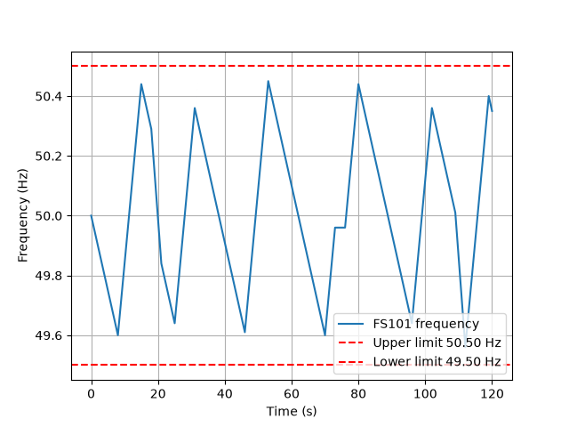
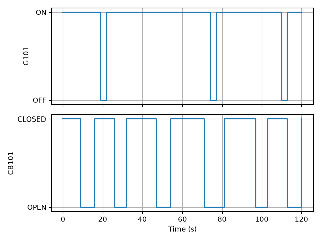

# Power Grid Simulator

A discrete-time simulator of a single-bus station power system: one diesel generator (G101), one circuit breaker (CB101), the station load (L101) and a frequency sensor (FS101). It models how the bus frequency changes, applies control logic that keeps the frequency inside its safe band, injects generator trips as fault scenarios, and plots the result.

The simulator runs in 1-second steps over a duration you choose. It produces two images: the bus frequency with its limits, and the on/off state of the generator and the breaker. It can run directly with Python or inside a Docker container.

## Table of contents

1. [Background and objective](#1-background-and-objective)
2. [Quick start](#2-quick-start)
3. [Project structure](#3-project-structure)
4. [The physical process](#4-the-physical-process)
5. [Components as implemented](#5-components-as-implemented)
6. [How the simulation works](#6-how-the-simulation-works)
7. [Control logic](#7-control-logic)
8. [Fault scenario: generator trips](#8-fault-scenario-generator-trips)
9. [Outputs](#9-outputs)
10. [Running locally, step by step](#10-running-locally-step-by-step)
11. [Docker containerisation (add-on)](#11-docker-containerisation-add-on)
12. [Verification performed](#12-verification-performed)
13. [Design assumptions](#13-design-assumptions)
14. [Behaviour notes](#14-behaviour-notes)
15. [Development history: build, break, fix](#15-development-history-build-break-fix)
16. [AI-assisted development](#16-ai-assisted-development)
17. [Glossary](#17-glossary)

---

## 1. Background and objective

The scenario comes from the task brief in `Power_Grid_Simulator_Task.docx`. A remote Arctic research station, 800 km from the nearest town, runs on a single diesel generator. It powers life support, heating, satellite communications and lab equipment for 40 researchers. Outside it is -35 °C. If the generator overloads and the breaker trips, heating stops, and the pipes freeze within about 90 minutes. The brief also describes a night when a faulty frequency reading caused an unnecessary breaker trip at 2 a.m., and three labs lost samples worth two years of data before the on-call engineer could reset the system.

The objective is to build a simulator for the station's single-bus distribution system that:

1. models the physical process,
2. implements control logic that keeps the bus frequency within safe bounds, and
3. displays the system state graphically.

### Components named in the brief

| Tag | Component | Role |
|---|---|---|
| G101 | Generator | The station's only diesel generator |
| CB101 | Circuit breaker | Connects or disconnects the station load from the bus |
| L101 | Station load | Heating, life support, labs and communications |
| FS101 | Frequency sensor | Measures the bus frequency |

### Design rules given in the brief

- Nominal frequency is **50.00 Hz**. Above **50.50 Hz** is over-frequency, and below **49.50 Hz** is under-frequency.
- Normal operation must never enter over-frequency or under-frequency.
- CB101 must never be CLOSED while the frequency is below 49.50 Hz.
- The station always needs power, so CB101 should be CLOSED whenever feasible.
- Frequency changes at fixed rates, depending on the generator and breaker states (see [section 4](#4-the-physical-process)).

### Functional requirements from the brief

- Control logic that keeps the frequency between 49.50 Hz and 50.50 Hz.
- Discrete time steps of one second, over a configurable duration.
- Three graphs over the simulation duration: the bus frequency as reported by FS101 with the limits marked, the state of G101, and the state of CB101.

---

## 2. Quick start

### With Docker

Run both commands from the project folder (the folder that contains `Simulator.py`):

```bash
docker build -t sim-test .
docker run -it --rm -v "$PWD":/app sim-test
```

### Without Docker

```bash
python3 -m venv .env
source .env/bin/activate
pip install -r requirements.txt
python3 Simulator.py
```

In both cases the program asks for two numbers: the simulation period in seconds, and the number of generator trips to inject. It then runs in real time (one simulated second takes one real second) and writes `frequency_wave.png` and `state_steps.png` into the folder.

---

## 3. Project structure

```
Power System Simulator/
├── Simulator.py                    main program: setup, control loop, scenario, plotting
├── Generator.py                    PowerGenerator class (G101)
├── Breaker.py                      CircuitBreaker class (CB101)
├── FrequencySensor.py              FrequencySensor class (FS101, holds the bus frequency)
├── Dockerfile                      container definition
├── requirements.txt                Python dependency list
├── README.md                       this document
├── Power_Grid_Simulator_Task.docx  the original task brief
├── docs/
│   ├── example_frequency_wave.png  example output used in this README
│   └── example_state_steps.png     example output used in this README
├── frequency_wave.png              generated on every run (overwritten)
├── state_steps.png                 generated on every run (overwritten)
├── __pycache__/                    generated by Python
└── .env/                           local Python virtual environment
```

### File by file

| File | What it contains |
|---|---|
| `Simulator.py` | Everything that runs: the plotting functions, the creation of the components, the user prompts, the trip scheduling, the one-second loop with the control logic, and the final console output and plots. |
| `Generator.py` | `PowerGenerator`, which holds one boolean `is_on` and the methods `on()` and `off()`. |
| `Breaker.py` | `CircuitBreaker`, which holds one boolean `is_open` and the methods `open()`, `close()` and `get_is_open()`. |
| `FrequencySensor.py` | `FrequencySensor`, which holds the bus frequency, starting at 50, and the methods that change it according to the physics. |
| `Dockerfile` | Builds the container image (see [section 11](#11-docker-containerisation-add-on)). |
| `requirements.txt` | A single line, `matplotlib`. |
| `docs/` | Two fixed example images, so that the pictures in this README do not change when you run the simulator. |
| `frequency_wave.png`, `state_steps.png` | The latest run's output. They are overwritten on every run. |
| `.env/` | The virtual environment used for local runs. It is not part of the program and should not be committed. |

---

## 4. The physical process

### 4.1 What the frequency is

A diesel generator is an engine that turns an electrical machine. **The bus frequency is the rotation speed of that machine.** At 50.00 Hz it turns at its normal speed. If it speeds up, the frequency rises, and if it slows down, the frequency falls.

Two things act on the spinning shaft:

- **The engine pushes it** (generator ON).
- **The load drags on it** (breaker CLOSED, which connects the station).

The speed changes whenever the push and the drag are not equal. Frequency therefore isn't a property of any single component. It results from the balance between engine and load. In the simulator, the only thing that changes the frequency is the combination of the generator state and the breaker state.

### 4.2 The four states and their rates

There are two on/off switches, so the system is always in one of four states. The brief gives the rate of frequency change for each:

| State | Generator | Breaker | Physical meaning | Rate of change |
|---|---|---|---|---|
| A | ON | CLOSED | The engine supplies the load but cannot fully keep up, so the shaft slowly loses speed | **-0.05 Hz/s** |
| B | ON | OPEN | No load, so the engine accelerates a free shaft | **+0.12 Hz/s** |
| C | OFF | CLOSED | The load drains the energy stored in the spinning mass | **-0.15 Hz/s** |
| D | OFF | OPEN | Nothing pushes and nothing drags | **0 Hz/s** |

```
                    GENERATOR ON                        GENERATOR OFF
              +--------------------------+        +--------------------------+
 BREAKER      | A: station powered       |        | C: station powered,      |
 CLOSED       | frequency falls 0.05/s   |        |    but dying             |
              | (normal working state)   |        | frequency falls 0.15/s   |
              +--------------------------+        +--------------------------+
              +--------------------------+        +--------------------------+
 BREAKER      | B: station dark          |        | D: station dark          |
 OPEN         | frequency rises 0.12/s   |        | frequency frozen         |
              | (recovery state)         |        | (dead end until restart) |
              +--------------------------+        +--------------------------+
```

Who moves the system between states:

| Transition | Caused by |
|---|---|
| A to B, and B to A | The controller opening or closing the breaker. This is the normal heartbeat. |
| A to C, and B to D | A generator trip. This is a fault that comes from outside the controller. |
| C to D | The controller opening the breaker to stop the fast fall. |
| D to B | The controller restarting the generator. Nothing else can leave state D. |
| C or D straight to A | Impossible. The generator must be restarted first, then the breaker closed. |

### 4.3 Normal operation: the sawtooth

With the generator running, **the breaker is the only control available**. A closed breaker always pulls the frequency down, and an open breaker always pushes it up. So healthy operation is not a steady 50 Hz. It is a sawtooth:

1. The breaker is closed and the frequency falls slowly (state A).
2. Before the frequency gets too low, the controller opens the breaker (state B). The station briefly loses power.
3. The frequency climbs quickly.
4. Once it has recovered enough, the controller closes the breaker and the slow fall starts again.

With this project's thresholds (open at 49.65 Hz, close at 50.35 Hz):

- Closed phase: from 50.35 Hz down to 49.65 Hz is 0.70 Hz at 0.05 Hz/s, which is **14 s**.
- Open phase: from 49.65 Hz up to 50.35 Hz is 0.70 Hz at 0.12 Hz/s, which is about **5.8 s**.
- One cycle is about 20 s.

The fraction of time the station is powered is fixed by the two rates alone:

```
uptime = (1/0.05) / ((1/0.05) + (1/0.12)) = 20 / (20 + 8.33) = 70.6 %
```

This does not depend on how wide the band is. A narrower band does not give more uptime. It only makes the breaker switch more often.

### 4.4 Fault operation: a generator trip

A trip turns the generator OFF. What happens next depends on the breaker:

- **Breaker CLOSED (state A to C).** This is the dangerous case. The frequency now falls at 0.15 Hz/s, three times faster than normal. From 49.90 Hz it crosses 49.50 Hz in under 3 seconds, so the controller must act almost immediately.
- **Breaker OPEN (state B to D).** This is safe. The frequency simply freezes at its current value, and the controller restarts the generator.
- **After the breaker opens in state C**, the system also ends up in state D: frozen, dark, and waiting for the restart.

### 4.5 Why the limits and margins matter

The simulation moves in whole seconds, and one second can change the frequency by up to 0.15 Hz. The controller only sees the frequency at the end of each second. If it waited until the frequency was below 49.50 Hz to act, the limit would already be crossed. The controller therefore acts early, by one worst-case step:

- Lower side: the worst one-second fall is 0.15 Hz, so the breaker opens at **49.50 + 0.15 = 49.65 Hz**.
- Upper side: the worst one-second rise is 0.12 Hz, so the breaker must close no later than **50.50 - 0.12 = 50.38 Hz**. The project closes at **50.35 Hz**.

---

## 5. Components as implemented

### G101: `PowerGenerator` (`Generator.py`)

| Item | Detail |
|---|---|
| Real-world role | The station's sole diesel generator |
| State | `is_on` (boolean). Starts `False`, and `Simulator.py` calls `on()` at start-up. |
| Methods | `on()` sets `is_on = True`. `off()` sets `is_on = False`. |
| Who calls it | The controller calls `on()` (restart). The scenario calls `off()` (trip). |

### CB101: `CircuitBreaker` (`Breaker.py`)

| Item | Detail |
|---|---|
| Real-world role | Connects the station load to the bus, or disconnects it |
| State | `is_open` (boolean). Starts `False`, which means CLOSED. |
| Methods | `open()` sets `is_open = True`. `close()` sets `is_open = False`. `get_is_open()` returns the value. |
| Naming note | The class stores `is_open`, so CLOSED is the value `False`. The plotting helper `breaker_to_binary` inverts it so that the graph shows 1 for CLOSED. |
| Who calls it | The controller opens and closes it. |

### L101: the station load

There is **no separate load class**. The load is represented by the breaker: the load is connected exactly when `is_open` is `False`. The load's size is not modelled. Its effect is already contained in the rates: it is the difference between the +0.12 Hz/s (no load) and -0.05 Hz/s (load connected) cases.

### FS101: `FrequencySensor` (`FrequencySensor.py`)

| Item | Detail |
|---|---|
| Real-world role | Measures the bus frequency |
| State | `frequency` (float). Starts at `50`. |
| Methods | `generator_providing_load()` subtracts 0.05. `generator_not_providing_load_running()` adds 0.12. `generator_off_and_load_running()` subtracts 0.15. `get_frequency()` returns the value. |
| Important note | In this version the sensor **holds the true bus frequency itself** and the physics rates are applied to it. The reading is therefore always exact. See [behaviour notes](#14-behaviour-notes). |
| State D | Generator OFF with breaker OPEN needs no method: the loop applies no change in that state. |

### The controller

There is no controller class. The control logic is the block of `if` statements inside the loop in `Simulator.py`, described in [section 7](#7-control-logic).

### Helper functions in `Simulator.py`

| Function | Purpose |
|---|---|
| `plot_frequency_wave(frequency_history)` | Draws the frequency curve with the two limit lines and saves `frequency_wave.png`. |
| `generator_to_binary(history)` | Converts the generator history from `True`/`False` to 1 (ON) or 0 (OFF). |
| `breaker_to_binary(history)` | Converts the breaker history to 1 (CLOSED) or 0 (OPEN). It inverts the stored `is_open`. |
| `plot_state_steps(generator_history, breaker_history)` | Draws the two state graphs as step plots and saves `state_steps.png`. |

---

## 6. How the simulation works

### 6.1 Inputs

When the program starts it asks for two integers:

| Prompt | Meaning | Handling |
|---|---|---|
| `Enter the simulation period in seconds:` | Duration of the run | If it is 0 or negative, the program prints `Simulation period must be greater than 0` and stops. |
| `Enter the number of trips:` | How many generator trips to schedule | Zero or negative gives no trips. If the requested number cannot fit, the program says so (see [section 8](#8-fault-scenario-generator-trips)). |

Anything that is not an integer stops the program with a `ValueError`.

### 6.2 Initial conditions

- Frequency: 50.00 Hz
- Generator G101: ON
- Breaker CB101: CLOSED
- The initial state is recorded as sample 0.

### 6.3 What happens in each second

Each pass through the loop is one second, in this fixed order:

1. **Physics.** Choose exactly one rate from the table in [section 4.2](#42-the-four-states-and-their-rates), using the current generator and breaker states, and apply it to the frequency.
2. **Record.** Append the new frequency, the generator state and the breaker state to the history lists.
3. **Breaker decisions.** If the frequency is at or below 49.65 Hz, open the breaker. If it is at or above 50.35 Hz **and** the generator is ON, close the breaker.
4. **Generator restart.** If the generator is OFF, count one more second. When the count reaches `RESTART_DELAY` (3), turn the generator ON and reset the count. If it is ON, the count is zero.
5. **Wait.** `time.sleep(1)` makes the run take real time.
6. **Advance the clock** by one second.
7. **Scenario trips.** If this second is one of the scheduled trip times, turn the generator OFF (or log that the trip was ignored if it is already OFF).
8. **Stop** when the clock reaches the requested duration.

After the loop, the program prints the full frequency list and writes the two images.

### 6.4 What one sample means

The record in step 2 is made after the physics step and before the decisions in step 3. So **each sample holds the frequency and the states that produced it**, not the states chosen afterwards. For example:

- A decision made after sample 8 appears in the states of sample 9.
- A trip scheduled at second 18 appears as OFF from sample 19.

This is why the breaker graph appears to react one second after the frequency turns. It is the true cause and effect: the decision comes first, and the next sample shows its result.

For a run of N seconds there are **N + 1 samples**, at t = 0 to t = N.

### 6.5 Recorded data

| List | Contents |
|---|---|
| `frequency_history` | Frequency in Hz at each sample, as raw floats |
| `generator_state` | `True` (ON) or `False` (OFF) at each sample |
| `breaker_state` | `is_open` at each sample (`True` means OPEN) |

---

## 7. Control logic

All control logic sits in the loop in `Simulator.py`. It has three rules.

### 7.1 Rule 1: open the breaker at 49.65 Hz or below

```
if frequency <= 49.65:  open the breaker
```

49.65 Hz is the lower limit of 49.50 Hz plus the worst one-second fall of 0.15 Hz (generator OFF with breaker CLOSED). If the frequency is above 49.65 Hz now, it is at least 49.50 Hz one second from now, even if the generator trips during that second. The breaker therefore opens before the limit can be crossed.

### 7.2 Rule 2: close the breaker at 50.35 Hz or above, if the generator is ON

```
if frequency >= 50.35 and generator is ON:  close the breaker
```

- **Why 50.35 Hz.** In state B the frequency rises 0.12 Hz per second. A reading just below 50.35 Hz can become at most 50.35 + 0.12 = 50.47 Hz before the breaker closes. That stays below the 50.50 Hz limit.
- **Why the generator must be ON.** Closing the breaker while the generator is OFF would connect the load to a dead machine, and the frequency would fall at 0.15 Hz/s. It is a safety interlock: the load is never reconnected to a stopped generator. In the trip scenarios of this project it never changes the outcome, because the breaker closes in the same second that the frequency reaches 50.35 Hz, before a trip can happen.

### 7.3 Why there are two different thresholds (hysteresis)

If the breaker were reclosed as soon as the frequency was back above the opening threshold, it would flip every few seconds. A real breaker would wear out, and the station would flicker. Using a low threshold to open and a much higher one to close removes that.

With the thresholds used here, each cycle keeps the breaker closed for about 14 seconds and open for about 6 seconds (see [section 4.3](#43-normal-operation-the-sawtooth)), instead of switching every few seconds.

### 7.4 Rule 3: restart the generator after a delay

When the controller sees the generator OFF, it counts seconds. After `RESTART_DELAY = 3` seconds it turns the generator ON.

For a trip scheduled at second `c`:

| Sample | Generator |
|---|---|
| c + 1, c + 2, c + 3 | OFF (three samples, equal to the delay) |
| c + 4 | ON again |

The trip is a scenario event, and the restart is a controller decision. The scenario never switches the generator back on. A fault that arrives in the same second as a restart takes effect and cancels the restart. The trip scheduler avoids this case (see [section 8](#8-fault-scenario-generator-trips)).

### 7.5 Guaranteed bounds

With exact arithmetic the rules give these bounds:

- The frequency cannot fall below **49.50 Hz**. Closed breaker, generator ON: 49.66 Hz falls to 49.61 Hz and then the breaker opens. Closed breaker, generator OFF: 49.66 Hz falls to 49.51 Hz and then the breaker opens.
- The frequency cannot rise above **50.47 Hz**.
- The breaker is never closed below 49.50 Hz.

Floating-point rounding can move these by about 1e-14 Hz and can delay a threshold by one step. See [behaviour notes](#14-behaviour-notes).

### 7.6 Worked example of the first cycle

| Seconds | State | Frequency |
|---|---|---|
| 0 to 8 | A (G ON, CB CLOSED) | 50.00 falls to 49.60 Hz |
| 8 | The reading 49.60 Hz is at or below 49.65 Hz, so the breaker opens | |
| 9 to 15 | B (G ON, CB OPEN) | 49.72 rises to 50.44 Hz |
| 15 | The reading 50.44 Hz is at or above 50.35 Hz, so the breaker closes | |
| 16 onward | A again | The fall starts again |

The 49.65 Hz reading at second 7 is not acted on, because of floating-point rounding. See [behaviour notes](#14-behaviour-notes).

---

## 8. Fault scenario: generator trips

A trip turns G101 OFF at a scheduled second. The program schedules trips at random.

### 8.1 How the trip times are chosen

For `n` requested trips:

- Each trip time is a random whole second from 1 to (duration - 1). The final second is excluded, because a trip there would happen after the last sample and never appear in the graphs.
- A new time is accepted only if it is at least `MIN_TRIP_GAP = RESTART_DELAY + 1 = 4` seconds from every trip already chosen. This guarantees that:
  - there are no duplicate trip times,
  - every trip hits a running generator, and
  - no trip lands in the same second as a restart.
- The scheduler gives up after 1000 attempts. If fewer than `n` trips were placed, it prints `Only X of N trips fit in Ts (trips must be at least 4s apart)` and runs with the trips that fit.
- Trip times are sorted and printed as `Trip times: [...]`.

### 8.2 What happens when a trip fires

| Situation | Console message | Effect |
|---|---|---|
| Generator was ON | `t=18s: G101 tripped` | Generator turns OFF |
| Generator was already OFF | `t=18s: trip ignored, G101 already OFF` | None |

The second message cannot occur with the randomly scheduled trips, because they are spaced far enough apart. It is a safety check in the trip step.

### 8.3 Edge cases

| Input | Behaviour |
|---|---|
| Duration of 1 second | No trip fits. The program reports it and runs normally. |
| More trips than fit | The shortfall is reported, and the trips that fit are run. |
| 0 or negative trips | No trips. |

---

## 9. Outputs

### 9.1 Console output

- The prompts and the chosen `Trip times: [...]`, plus the shortfall message if any.
- One line per trip as it fires.
- At the end, the complete frequency history as a Python list of raw floats.

### 9.2 `frequency_wave.png`

The bus frequency as reported by FS101, over time.

- X axis: time in seconds. Y axis: frequency in Hz.
- Blue line: the frequency.
- Two red dashed lines: the upper limit (50.50 Hz) and the lower limit (49.50 Hz). A healthy run stays between them.
- A legend and a grid.

### 9.3 `state_steps.png`

Two stacked step graphs with a shared time axis.

- **G101:** OFF at the bottom, ON at the top.
- **CB101:** OPEN at the bottom, CLOSED at the top.
- Step graphs (not slanted lines) because the states switch instantly.

Both files are written to the current folder and overwritten on every run.

### 9.4 Example run

The example below used 120 seconds and 3 trips. It was produced with Python's random generator seeded at 1, so the trip times are fixed:

```bash
python3 -c "import random; random.seed(1); exec(open('Simulator.py').read())"
```

Enter `120` and then `3`. The shipped script does not seed the generator, so a normal run produces different trip times. The shape of the graphs is similar.





Trips fired at 18 s, 73 s and 109 s.

| Seconds | What happens |
|---|---|
| 0 to 8 | G ON, CB CLOSED. The frequency falls from 50.00 to 49.60 Hz. |
| 9 to 15 | The breaker is OPEN and the frequency rises to 50.44 Hz. It recloses (visible from 16). |
| 18 | **Trip 1, breaker closed.** |
| 19 to 21 | Generator OFF, breaker CLOSED. The frequency falls 0.15 Hz per second: 50.14, 49.99, 49.84 Hz. The controller restarts the generator after three samples. |
| 22 to 25 | Generator ON again. The outage was survived with the breaker still closed. The frequency reaches 49.64 Hz at second 25, so the breaker opens (visible from 26). |
| 26 to 31 | Breaker OPEN, the frequency rises to 50.36 Hz, the breaker recloses (visible from 32). |
| 47, 54 | The breaker opens at 47 and recloses at 54. The peak is 50.45 Hz at second 53. |
| 71 | The breaker opens. |
| 73 | **Trip 2, breaker open.** The frequency freezes at 49.96 Hz for samples 74 to 76 (state D). |
| 77 to 80 | The generator is back. The frequency rises to 50.44 Hz. The breaker recloses (visible from 81). |
| 97, 103 | The breaker opens at 97 and recloses at 103. |
| 109 | **Trip 3, breaker closed.** |
| 110 to 112 | Generator OFF, breaker CLOSED. The frequency falls 50.01, 49.86, 49.71, 49.56 Hz. This is the closest approach to the lower limit, only 0.06 Hz above it. |
| 113 to 120 | The breaker opens (visible from 113), the generator is restored, the frequency recovers to 50.40 Hz, and the breaker recloses (visible from 120). |

Summary statistics for this run:

| Measure | Value |
|---|---|
| Samples | 121 (t = 0 to 120) |
| Lowest frequency | 49.56 Hz, at t = 112 |
| Highest frequency | 50.45 Hz, at t = 53 |
| Samples outside 49.50 to 50.50 Hz | 0 |
| Samples with the breaker CLOSED below 49.50 Hz | 0 |
| Breaker opens | 6 |
| Breaker closes | 6 |
| Generator OFF samples | 9 (three outages of three samples each) |
| Fraction of samples with the breaker CLOSED | 64.5 % |

The closed fraction is below the 70.6 % ceiling in [section 4.3](#43-normal-operation-the-sawtooth). That is expected, because the generator outages add time with the breaker open.

---

## 10. Running locally, step by step

### 10.1 Prerequisites

- Python 3.13 (the project was developed on 3.13.5)
- `matplotlib` (the project used 3.11.2)

### 10.2 Steps

1. **Open a terminal in the project folder**, the one containing `Simulator.py`.
2. **Create a virtual environment** (skip if `.env/` already exists):
   ```bash
   python3 -m venv .env
   ```
3. **Activate it:**
   ```bash
   source .env/bin/activate
   ```
4. **Install the dependency:**
   ```bash
   pip install -r requirements.txt
   ```
5. **Run the simulator:**
   ```bash
   python3 Simulator.py
   ```
6. **Answer the two prompts**, for example `120` and `3`.
7. **Wait.** One simulated second takes one real second, so 120 seconds takes two minutes.
8. **Open the two images** in the project folder.

### 10.3 Sample session

```text
Enter the simulation period in seconds: 120
Enter the number of trips: 3
Trip times: [18, 73, 109]
t=18s: G101 tripped
t=73s: G101 tripped
t=109s: G101 tripped
[50, 49.95, 49.900000000000006, 49.85000000000001, ...]
```

Your trip times will differ, because they are random.

### 10.4 Running faster

The wait comes from the line `time.sleep(1)` inside the loop. To run instantly, comment that line out. The results are identical, because the simulation does not depend on real time.

---

## 11. Docker containerisation (add-on)

Docker is an optional way to run the simulator without installing Python or matplotlib on your machine.

### 11.1 The Dockerfile, line by line

```dockerfile
from python:3.13.17-slim-trixie
copy ./ /app
workdir /app
run pip install -r requirements.txt
cmd python3 Simulator.py
```

| Line | What it does |
|---|---|
| `from python:3.13.17-slim-trixie` | Starts from a small Python 3.13.17 image |
| `copy ./ /app` | Copies the project folder into `/app` inside the image |
| `workdir /app` | Makes `/app` the working directory |
| `run pip install -r requirements.txt` | Installs matplotlib while the image is built |
| `cmd python3 Simulator.py` | Runs the simulator when a container starts |

The image used during testing had Python 3.13.17 and matplotlib 3.11.2, and matplotlib used the headless `agg` backend. No display is needed, because the program only saves image files.

### 11.2 Build the image

From the project folder:

```bash
docker build -t sim-test .
```

You only need to build again if you change the `Dockerfile` or `requirements.txt`.

### 11.3 Run the container

From the project folder:

```bash
docker run -it --rm -v "$PWD":/app sim-test
```

| Part | Meaning |
|---|---|
| `-it` | Attach your keyboard, which the prompts need |
| `--rm` | Delete the container when it ends |
| `-v "$PWD":/app` | Mount the current folder onto `/app` inside the container |
| `sim-test` | The image to run |

### 11.4 Where the output goes

The `-v` option makes the container see your host folder as `/app`. The simulator saves its images into its working directory, which is `/app`, so **the two PNG files appear in the folder you mounted**.

The mount also **replaces** the `/app` that was copied into the image. The container therefore runs the code from your host folder. That has two consequences:

- **Run the command from the project folder.** The mounted folder must contain `Simulator.py` and the other `.py` files. If you mount an empty folder, or a folder without the code, it fails with `can't open file '/app/Simulator.py'`. This was tested.
- **Code changes need no rebuild.** Only changes to the `Dockerfile` or `requirements.txt` do.

If you run the container **without** `-v`, it works, but the images are created inside the container and are deleted with it (`--rm`).

### 11.5 Running without typing the answers

Pipe the two answers in and use `-i` instead of `-it`, because a pipe is not a terminal:

```bash
printf "120\n3\n" | docker run -i --rm -v "$PWD":/app sim-test
```

The simulator still takes the full real time of the duration you enter.

### 11.6 Platform note

On Docker Desktop for macOS, only folders that Docker Desktop shares can be mounted. During testing, a folder under `/tmp` appeared empty inside the container, while a folder under the home directory worked. Keep the project under your home folder. The commands in this README use the `$PWD` variable of bash and zsh.

### 11.7 Troubleshooting

| Symptom | Likely cause | Fix |
|---|---|---|
| `can't open file '/app/Simulator.py'` | The mounted folder has no code | Run from the project folder |
| The container sees an empty `/app` even from the project folder | The folder is not shared with Docker Desktop | Move the project under your home folder, or add the folder under Docker Desktop's file sharing settings |
| `the input device is not a TTY` | `-it` used with piped input | Use `-i` with piped input |
| `EOFError: EOF when reading a line` | No input attached | Use `-it`, or pipe the answers in |
| `ValueError: invalid literal for int()` | A non-integer answer | Enter whole numbers |
| No PNG files after the run | No `-v` mount, or ran from another folder | Use the command from [section 11.3](#113-run-the-container) in the project folder |

### 11.8 Image size

The image built during testing used about 690 MB on disk. Part of that is because `copy ./ /app` also copies `.env/`, the `.docx` brief, the generated PNGs and `__pycache__/`.

---

## 12. Verification performed

These checks were run as ad-hoc scripts, in temporary copies of the project with the real-time wait removed. They are not an automated test suite in the repository.

| Check | Result |
|---|---|
| Rates for all four generator and breaker states | Each state produced the expected slope in a traced run |
| Scripted trips at 3, 8 and 11 s with controller restart | No limit crossed, and the generator came back each time |
| Trip while the breaker was open at a high frequency, with and without the "generator ON" rule | Identical results, because the scripted run never reaches that state |
| 300 random runs of 60 s with 5 trips | All 1,500 trips fired, none ignored, no frequency outside 49.50 to 50.50 Hz |
| Too many trips (20 s with 10 trips) | Reported `Only 5 of 10 trips fit in 20s` and ran the 5 that fit |
| Edge cases (1 s, 2 s, 0 trips) | Ran without errors |
| Forced trip list `[5, 6, 20]` | The trip at 6 s logged `trip ignored, G101 already OFF` |
| Seeded 120 s run with 3 trips (section 9.4) | No violations, minimum 49.56 Hz, maximum 50.45 Hz |
| Docker run from the project folder | Worked, and the PNGs appeared in the mounted folder |
| Docker run from an empty folder | Failed with `can't open file '/app/Simulator.py'` |
| Seeded reproduction command (section 9.4) | Worked and produced fixed trip times |

---

## 13. Design assumptions

1. **Time step.** One second. The duration is a whole number of seconds entered by the user.
2. **Starting state.** 50.00 Hz, generator ON, breaker CLOSED.
3. **One rate per second.** Each second the frequency changes by exactly one rate, determined by the generator and breaker states at that moment.
4. **Load.** The load is connected exactly when the breaker is closed. Its size is not modelled beyond the rates given in the brief.
5. **Perfect sensor.** The controller sees the true frequency, and it sees the generator state directly.
6. **Thresholds.** The breaker opens at 49.65 Hz or below and closes at 50.35 Hz or above (with the generator ON). The margins come from the worst-case one-second change (0.15 Hz down and 0.12 Hz up).
7. **Instant switching.** The breaker and the generator change state instantly. There is no mechanical delay and no minimum time between breaker operations.
8. **Restart.** The controller restarts the generator after 3 seconds OFF. A restart always succeeds. The brief gives no restart time, so 3 seconds is an assumption.
9. **Trips.** A trip is instant. Trip times are random, unique, at least 4 seconds apart, and never in the final second. A trip that finds the generator already OFF would be ignored and logged.
10. **Limits.** Over-frequency is strictly above 50.50 Hz and under-frequency is strictly below 49.50 Hz, so exactly 49.50 Hz and exactly 50.50 Hz are acceptable.
11. **Samples.** Sample `t` holds the frequency after `t` steps, together with the states that produced it.
12. **Breaker and generator interaction.** The breaker can be opened with the generator OFF. It is only reclosed with the generator ON.

---

## 14. Behaviour notes

These are properties of the current implementation that affect how to read the results.

| Behaviour | Effect |
|---|---|
| **The frequency is stored as raw floats.** After seven steps of -0.05 from 50, Python gives `49.65000000000002`, which is not `<= 49.65`. | A threshold can trigger one second later than calculated. In the example run the breaker opened at 49.60 Hz and not at 49.65 Hz. The console output also shows values such as `49.900000000000006`. |
| **FS101 holds the true frequency.** The controller reads the sensor, and the sensor value is the true bus frequency. | The reading is always exact. Sensor faults are not simulated. |
| **There is no load class and no controller class.** | The load is represented by the breaker state, and the control logic is the block of `if` statements in the loop. |
| **The constants are fixed in `Simulator.py`:** 49.65, 50.35 and `RESTART_DELAY = 3`. | Changing a threshold means editing the file. |
| **The trip times are not seeded.** | The same inputs give different trip times on each run. |
| **The loop waits one real second per simulated second.** | A run takes as long as the duration you enter. Comment out `time.sleep(1)` to skip the wait. |
| **Input is interactive.** | The program asks two questions on every run. The answers can be piped in (see [section 11.5](#115-running-without-typing-the-answers)). |
| **The simulator does not check for limit violations itself.** | Violations are found by reading the graphs. |
| **There is no automated test suite in the repository.** | The checks in [section 12](#12-verification-performed) were run as separate temporary scripts. |
| **The legend uses matplotlib's default placement.** | In some runs it covers part of the frequency curve. |
| **The Docker image copies the whole project folder**, including `.env/`. | The image built during testing used about 690 MB on disk. |
| **Output goes to the folder mounted on `/app`.** | With the Docker command, the graphs always appear in the project folder. |

---

## 15. Development history: build, break, fix

The simulator was built in small steps. Each step was run, looked at, and fixed when it was wrong.

| Step | What was built | What went wrong | What fixed it |
|---|---|---|---|
| 1 | The first component classes and a mental model of the physics | The sensor was changing the frequency itself, some methods lacked `self`, file names did not match imports, and the generator started OFF | Corrected the classes and set the generator ON at start |
| 2 | A frequency graph with limit lines, and a simple rule: open the breaker below 49.50 Hz | The frequency dipped to about 49.45 Hz, because the rule acted after the limit was crossed. The breaker was never closed again | The rule was moved earlier (see step 5) |
| 3 | A step graph for the generator and breaker states | It showed the breaker stuck OPEN after about 11 seconds, which exposed the missing reclose rule | A reclose rule was added |
| 4 | The +0.12 Hz rate for generator ON with breaker OPEN | The frequency was frozen at about 49.57 Hz, because the rise only applied on the tick where the limit was crossed. After that fix it ran away to about 51.8 Hz, because nothing closed the breaker | One rate chosen per second from the states, plus a reclose rule |
| 5 | Open at 49.65 Hz, close at 50.35 Hz | The first opening came at 49.60 Hz instead of 49.65 Hz, because of floating-point rounding | Left as it is, and described in [section 14](#14-behaviour-notes) |
| 6 | Scripted generator trips | The scenario was also turning the generator back on, so the controller was not really restarting it | The restart moved into the controller (a 3-second timer). The scenario only trips |
| 7 | Reclose rule with a generator check | It had no visible effect in the scripted run | Kept as a safety rule: the load is never reconnected to a stopped generator |
| 8 | Interactive duration and random trips | Trips could duplicate, land on an already-OFF generator, or fall in the last second, so some would silently disappear | Unique times, a minimum gap, no trips in the last second, a shortfall message, and a log line per trip |
| 9 | Docker | A mount of an empty folder made the container fail. A first test under `/tmp` looked empty because Docker Desktop did not share that path | Documented that the command must run from the project folder, and that the folder must be shared with Docker Desktop |

---

## 16. AI-assisted development

An AI coding assistant (the agent in the Cursor editor) was used during development. It helped to explain the physical process, review the code and graphs, find the bugs listed in [section 15](#15-development-history-build-break-fix), propose the control rules, and check changes by running them in temporary copies of the project. The design decisions and the final code were the author's.

---

## 17. Glossary

| Term | Meaning |
|---|---|
| Bus | The shared electrical connection that the generator and the load attach to |
| Frequency | The rotation speed of the generator, expressed in hertz |
| Over-frequency | Frequency strictly above 50.50 Hz |
| Under-frequency | Frequency strictly below 49.50 Hz |
| Trip | The generator shutting down unexpectedly |
| Hysteresis | Using different thresholds for opening and closing, to stop rapid switching |
| Sawtooth | The repeating slow-fall, fast-rise shape of the frequency in normal operation |
| Sample | One recorded set of values (frequency, generator state, breaker state) at one second |
| Tick | One pass through the simulation loop, equal to one simulated second |
| Mount (`-v`) | Making a host folder visible inside a container |
